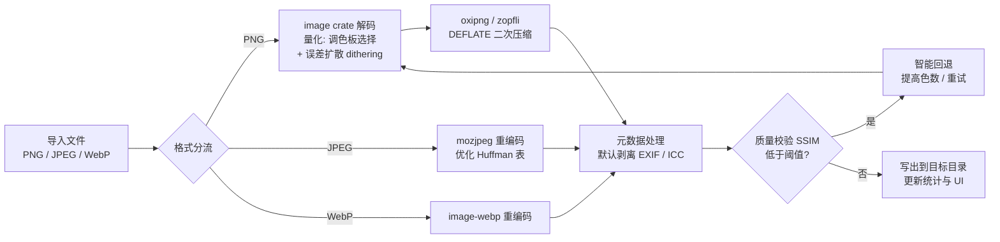

# 图小小 TinyImg — PC 端图片批量压缩工具 PRD

> 对标 TinyPNG 的本地桌面端产品。简单版 PRD，MVP 范围。

## 0. 迭代记录

| 日期 | 变更 | 决策人 |
|---|---|---|
| 2026-10-16 v1 | 初版 PRD：Tauri 2.x GUI 形态 | 许清楚 |
| 2026-10-16 v2 | **用户要求调整为 Rust 实现、包体要小、前期命令行选图** → 交付形态改为 **Rust CLI 优先**（M1 已交付，二进制 1.0 MB），GUI（原 M2-M4）顺延为 M3。压缩管线 P0 需求不受影响 | Bruce |
| 2026-10-17 v3 | **GUI 首批功能交付**（`src-tauri/`，Tauri 2.12）：输入支持选择单个文件 / 整个文件夹（原生对话框 + 系统拖拽），输出类型可选择且**默认 WebP**，输出文件夹自选，**记忆上次打开位置**（`~/Library/Application Support/cn.tinyimg.desktop/prefs.json`）。前端为原生 HTML/CSS/JS（无构建链），视觉沿用蓝绿清新规范。PRD 其余 P0/P1（三档预设、元数据开关、深浅主题、前后对比、Toast 通知）排入后续迭代 | Bruce |

> 当前实现状态见 `README.md` 与 `docs/DESIGN.md`。

## 1. 项目信息

| 项 | 内容 |
|---|---|
| Language | 简体中文（界面、提示、文档全部中文） |
| Programming Language | **Rust（Tauri 2.x 后端）+ React + TypeScript + Tailwind CSS（Vite）** |
| Project Name | `tinyimg_pc`（应用名：图小小 TinyImg） |
| 产品形态 | PC 桌面客户端（Tauri 2.x，首发 macOS，预留 Windows/Linux） |
| 原始需求复述 | 分析 TinyPNG（tinypng.com）的图片压缩原理，设计并开发一个类似的 PC 端产品：本地批量压缩 PNG/JPEG（及 WebP），实现"视觉无损、体积大减"，带前后对比、统计面板与参数设置 |

**压缩原理输入（来自主理人分析，作为技术需求基线）**：
1. 量化（Quantization）：24-bit 真彩 PNG → 8-bit 索引色（256 色及以下调色板），丢弃人眼不敏感的颜色信息
2. 量化算法：类 Median Cut / k-means 改进调色板选择 + 精细误差扩散（dithering）控制
3. 无损增强：量化后数据用 zopfli（DEFLATE 改进）二次压缩
4. 元数据剥离：去除 EXIF、ICC profile 等冗余元数据（默认开启，可关闭）
5. JPEG 处理：重编码 + 优化 Huffman 表 + 剥离元数据
6. 智能回退：量化质量下降明显时自动调整策略（重试/提高色数），守住"视觉无损"承诺

## 2. 产品定义

### 2.1 产品目标（Product Goals）

| # | 目标 | 成功指标（可度量） |
|---|---|---|
| G1 | **本地离线实现"视觉无损"批量压缩**：PNG 走量化 + 误差扩散 + zopfli/oxipng 增强，JPEG 走 mozjpeg 重编码，默认剥离元数据 | 高质量档平均压缩率：PNG ≥ 60%、JPEG ≥ 40%；画质 SSIM ≥ 0.98；全程本地处理，零网络请求 |
| G2 | **极低操作成本**：拖入即压，队列/进度/前后对比/统计一屏尽览 | 导入到完成 ≤ 3 次点击；100 张图（合计 ≤ 500MB）批处理期间 UI 不卡死、可随时取消 |
| G3 | **桌面级清爽体验**：蓝绿清新配色、有视觉张力、深浅双主题、中文界面 | 冷启动 ≤ 2s；操作反馈 ≤ 100ms；支持深浅色切换且记忆选择 |

### 2.2 目标用户

- **前端/全栈开发者**：压缩网站图片素材，替代手动开网页版 TinyPNG
- **设计师/内容运营**：截图、Banner、Icon 输出 Web 前统一瘦身
- **独立开发者/小团队**：批量处理产品资产，不想被上传次数和体积限制卡住
- **隐私敏感用户**：图片不外传，本地完成压缩

### 2.3 用户故事（User Stories）

| # | 用户故事 |
|---|---|
| US1 | 作为前端开发者，我想把整个素材文件夹拖进窗口一次性压缩，以便快速拿到可上线的小体积图片，而不必逐张上传网页版。 |
| US2 | 作为设计师，我想在列表里看到每张图的缩略图、原体积、压缩后体积和压缩率，以便判断哪些图值得替换原文件。 |
| US3 | 作为谨慎的用户，我想用前后对比滑块检查画质损失，以便放心采用"视觉无损"的压缩结果。 |
| US4 | 作为重度用户，我想在设置里选择质量档位（高/中/低）并控制是否保留元数据、输出到哪里，以便按场景权衡画质与体积。 |
| US5 | 作为批量处理用户，我想看到总节省体积、平均压缩率和处理进度，以便掌握任务整体情况。 |

## 3. 技术规范

### 3.1 压缩管线（Rust 侧）



Rust 依赖预选型：`image`（解码/量化）、`oxipng`（PNG 优化）、`mozjpeg` 系 crate（JPEG 重编码）、`image-webp`（WebP）、SSIM 计算（如 `dssim-core` 或自实现）用于回退判定。

### 3.2 需求池（P0/P1/P2）

| 优先级 | 需求 | 验收标准 |
|---|---|---|
| **P0** | 拖拽 / 点击选择批量导入（PNG、JPEG） | 拖入窗口高亮反馈；支持多选与文件夹；非支持格式给出明确提示 |
| **P0** | 压缩队列与进度（后台并发，UI 不冻结） | 每张图有状态（等待/处理中/完成/失败）；显示总体进度条；可取消单个/全部 |
| **P0** | PNG 核心压缩：量化 + 误差扩散 + zopfli 增强 | 高质量档平均压缩率 ≥ 60%，SSIM ≥ 0.98 |
| **P0** | JPEG 核心压缩：mozjpeg 重编码 + 元数据剥离 | 平均压缩率 ≥ 40%，肉眼无明显劣化 |
| **P0** | 压缩列表：缩略图、原体积、压缩后体积、压缩率、状态 | 列表实时刷新；体积人类可读（KB/MB）；压缩率带正负色标识（省=绿） |
| **P0** | 压缩统计面板：总节省体积、平均压缩率、完成数/总数 | 随队列实时更新；空列表时显示占位态 |
| **P0** | 输出目录选择 + 默认输出策略 | 默认输出到"图片目录/TinyImg输出"子目录；可自选目录；**不覆盖原文件**（安全默认） |
| **P0** | 质量档位设置：高 / 中 / 低 三档预设 | 高=256 色+dithering；中=128 色；低=64 色；默认"高" |
| **P0** | 保留元数据开关（默认关闭=剥离） | 开关即时作用于后续任务 |
| **P0** | 蓝绿清新 UI + 深浅色主题 + 中文界面 | 主题切换流畅；刷新后记忆选择 |
| **P1** | 前后对比：点击列表项弹出对比模态（滑块 / 并排） | 对比图支持拖动分割线；显示体积差异；ESC 关闭 |
| **P1** | WebP 导入与压缩 | 支持有损/无损 WebP 重编码，压缩率不低于 JPEG 档水平 |
| **P1** | 自定义档位：高级设置中开放量化色数微调（32–256） | 滑块实时预览预估效果（可选）；设置持久化 |
| **P1** | 失败重试与单张重新压缩 | 失败项显示原因；支持一键重试 |
| **P1** | 打开输出目录 / 定位输出文件 | 点击跳转系统文件管理器 |
| **P1** | 处理通知：批量完成后系统通知（可选开启） | 窗口失焦时也能感知完成 |
| **P2** | AVIF / HEIC 等更多格式输入 | 视 Rust 生态成熟度评估 |
| **P2** | 尺寸缩放（Resize）预设 | 如"最大宽 1920"选项 |
| **P2** | 压缩历史记录与会话恢复 | 重启后恢复上次列表 |
| **P2** | 预设方案保存与分享（导出/导入 JSON） | — |
| **P2** | 图片预览增强：缩放、多选对比 | — |
| **P2** | Windows / Linux 打包分发 | 首发 macOS，后续排期 |

**本期 MVP 范围建议**：P0 全部 + P1 中的「前后对比」「WebP 支持」。
理由：前后对比是"视觉无损"信任链的核心；WebP 是现代 Web 常用格式，缺失会让工具显得不完整。自定义色数与通知可放二期，首批用户用三档预设已覆盖 90% 场景。

### 3.3 UI 设计稿

**整体风格**：蓝绿清新（主色 teal/cyan 渐变），大圆角卡片、毛玻璃质感、微妙动效；深色为深蓝绿底、浅色为近白青底；强调"省了 XX%"的视觉冲击（大号渐变数字）。

#### 3.3.1 主窗口布局（约 1200 × 800，可缩放，最小 960 × 640）

```
┌──────────────────────────────────────────────────────────────────────────┐
│  ⬢ 图小小 TinyImg                          [🌙 浅色/深色]  [⚙ 设置]      │
├──────────────────────────────────────────────────────────────────────────┤
│                                                                          │
│   ┌───────────────────────────────────────────┐   ┌──────────────────┐  │
│   │                                           │   │  📊 压缩统计      │  │
│   │        ╭─────────────────────╮            │   │                  │  │
│   │        │      🖼 拖拽图片到此处  │            │   │   已省 128.4 MB   │  │
│   │        │   或 点击选择文件      │            │   │   平均压缩 -68%  │  │
│   │        │  支持 PNG / JPEG / WebP │         │   │   完成 24 / 30   │  │
│   │        ╰─────────────────────╯            │   │  ▓▓▓▓▓▓▓░░░ 80%  │  │
│   │         （拖入时整区高亮 + 缩放动效）        │   └──────────────────┘  │
│   └───────────────────────────────────────────┘                          │
│                                                                          │
│   ┌──────────────────────────────────────────────────────────────────┐   │
│   │ 文件名        原体积    压缩后    压缩率    状态      操作          │   │
│   │ ┌──┐ banner.png  2.4 MB   0.6 MB   -75% ✅ 完成   [对比][重来]    │   │
│   │ │图│ photo.jpg   1.1 MB   0.5 MB   -55% ✅ 完成   [对比]          │   │
│   │ └──┘ icon.webp   340 KB    92 KB   -73% ⏳ 处理中  —              │   │
│   │      big.png    12 MB    2.1 MB   -83% ⏸ 等待    —                │   │
│   └──────────────────────────────────────────────────────────────────┘   │
│                                                                          │
│   输出目录: ~/Pictures/TinyImg输出  [更改]                                │
│   [ ▶ 开始压缩 ]   [ 清空列表 ]                          共 30 个文件      │
└──────────────────────────────────────────────────────────────────────────┘
```

布局说明：
- 顶栏：品牌标识（渐变 Logo）+ 主题切换 + 设置入口
- 左上主区：拖拽区（空态时占据视觉中心，带呼吸感动效）；有文件时上方保留小型拖拽条
- 右上：统计卡片（节省体积用渐变大字，视觉冲击点）
- 中部：压缩列表（缩略图 + 体积 + 压缩率 + 状态徽章 + 行内操作）
- 底栏：输出目录、开始/清空按钮、文件计数

#### 3.3.2 设置面板（右侧抽屉 / 模态）

```
┌───────────────────────────────┐
│  设置                     [✕] │
│                               │
│  压缩质量                      │
│   ┌─────────┐ ┌─────────┐ ┌─────────┐
│   │  高 ✅  │ │   中    │ │   低    │
│   │ 256 色  │ │ 128 色  │ │ 64 色   │
│   │ 画质优先│ │ 均衡    │ │ 体积优先│
│   └─────────┘ └─────────┘ └─────────┘
│                               │
│  高级                          │
│   自定义色数  [────●──────] 128   （P1）│
│   ☐ 保留元数据（EXIF / ICC）           │
│                               │
│  输出                          │
│   输出目录  ~/Pictures/TinyImg输出 [更改]│
│   ☐ 完成后打开输出目录（P1）            │
│   ☐ 完成后发送系统通知（P1）            │
│                               │
│  关于                          │
│   图小小 TinyImg v0.1 · 本地处理  │
└───────────────────────────────┘
```

#### 3.3.3 前后对比模态（P1）

```
┌──────────────────────────────────────────────────┐
│  banner.png 对比                            [✕]  │
│  ┌──────────────────────────────────────────┐    │
│  │   原图                │   压缩后          │    │
│  │                       │                   │    │
│  │         ◀── 拖动分隔线 ──▶                │    │
│  │                       │                   │    │
│  └──────────────────────────────────────────┘    │
│   2.4 MB ─────────────▶ 0.6 MB   省 75% · SSIM 0.99│
│   [ 使用压缩结果并定位文件 ]                        │
└──────────────────────────────────────────────────┘
```

#### 3.3.4 状态与反馈

- 空态：拖拽区居中，文案 + 图标 + 呼吸光效
- 拖入悬停：整窗边框高亮（teal 渐变描边）
- 处理中：列表行进度微光条 + 统计卡百分比滚动
- 完成：Toast "已压缩 30 张，共节省 128 MB"（大数字强调成就感）
- 失败：行内红色徽章 + 原因 Tooltip（如"文件损坏"）

### 3.4 待确认问题（Open Questions，列给用户）

| # | 问题 | 建议默认值 |
|---|---|---|
| Q1 | **输出目录策略**：默认输出到固定子目录（如 `~/Pictures/TinyImg输出`）还是"与原文件同目录 + `-min` 后缀"？是否提供"覆盖原文件"选项（默认关闭）？ | 默认子目录；不覆盖原文件 |
| Q2 | **WebP/AVIF 支持范围**：MVP 是否就要 WebP？AVIF 是否进入路线图（P2）？ | MVP 含 WebP；AVIF 列 P2 |
| Q3 | **质量档位设计**：高/中/低三档（256/128/64 色）是否合适？是否需要第 4 档"极限"（如 32 色）？JPEG 侧档位如何映射（quality 90/80/70）？ | 三档 + 高级自定义色数 |
| Q4 | **单文件体积上限**：是否限制（如 50MB/100MB）？超大图（如 100MB PNG）如何处理——拒绝、警告还是尝试？ | 100MB 警告但仍处理 |
| Q5 | **"视觉无损"承诺的量化标准**：是否对外宣称 SSIM ≥ 0.98（高质量档）？需要可复现的评测集吗？ | 对外用"视觉无损"，内部以 SSIM ≥ 0.98 为回退阈值 |
| Q6 | **分发方式**：macOS 首发，是否同期出 Windows？是否开源（影响 crate 选型与 License，如 mozjpeg 的 BSD-like 许可）？ | 首发 macOS；License 待定 |
| Q7 | **文件夹递归导入**：拖入文件夹时是否递归处理子目录并保留目录结构？ | 递归 + 保留结构 |
| Q8 | **并发数**：默认同时处理几张图（建议 = CPU 核心数 - 1）？是否允许设置？ | 默认核心数-1，可设置 |

## 4. 里程碑建议（MVP）

| 阶段 | 内容 | 出口标准 |
|---|---|---|
| M1 核心管线 | Rust 压缩核心 + CLI 冒烟测试 | 单张 PNG/JPEG 压缩达标（G1 指标） |
| M2 桌面壳 | Tauri 窗口 + 拖拽导入 + 队列 + 列表 + 统计 | 跑通 100 张批量不卡死 |
| M3 体验完整 | 设置面板 + 三档预设 + 元数据开关 + 主题 + 前后对比 | P0 + 对比/WebP 全部验收通过 |
| M4 打磨发布 | Toast/通知/动效/打包签名 | 可分发测试版 |
